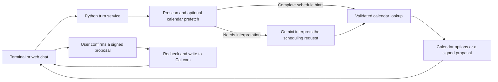

# LiveX Scheduling Assistant

A conversational Python assistant for managing your own Cal.com calendar. Book with a guest, see your agenda, and move or cancel a meeting by typing in the terminal or the streaming web chat. Every calendar change requires a separate confirmation.

[Vercel Preview](https://livex-scheduling-assistant-42s14zt22-zenith-dbf8.vercel.app) · [Local web chat](http://localhost:3000) · [Deployment plan](docs/deploy-plan.md)

The chat opens directly on a single-owner test calendar with fictional guests. The hosted Preview still requires Vercel project access while its domain exception is pending. A deployment connected to a private calendar would use the owner's own login, such as Cal.com OAuth.

## Requirements

> Meet your user: a busy founder who lives in their inbox and runs their day out of cal.com. They don't want forms or menus — they just want to type things like "book a 30-min intro with a candidate Thursday afternoon", "what's on my calendar tomorrow?", or "move my 3pm to later today" and have it handled. Your task is to build an interactive chatbot that lets this user manage their cal.com account through plain conversation. How you build the conversational layer is up to you. You are free to use any LLM provider.

| Try typing | What the assistant does | Cal.com REST API |
| --- | --- | --- |
| `book a 30-min intro with a candidate Thursday afternoon` | Finds 30-minute openings on Thursday afternoon and collects the guest's name and email in chat. It includes the intro purpose when the event supports notes and asks for confirmation. | `GET /v2/slots`, `POST /v2/bookings` |
| `what's on my calendar tomorrow?` | Shows tomorrow's meetings from the owner's calendar in chronological order for the chat's time zone. | `GET /v2/bookings` |
| `move my 3pm to later today` | Looks up the current 3 p.m. meeting, asks which meeting if several match, and offers later openings. If the rest of today is full, it offers the closest available times on later dates. | `GET /v2/bookings`, `GET /v2/bookings/{uid}`, `GET /v2/slots`, `POST /v2/bookings/{uid}/reschedule` |
| `Cancel my 4pm tomorrow` | Checks the matching booking and asks you to confirm the cancellation. Requests to cancel several meetings show the matches and ask you to choose one. | `GET /v2/bookings`, `GET /v2/bookings/{uid}`, `POST /v2/bookings/{uid}/cancel` |

The client uses `GET /v2/me` and `GET /v2/event-types` to find the host and eligible events. The single-booking read also helps verify changes when a write times out. [Cal.com API verification](docs/calcom-notes.md)

Type an offered time or say “the second one.” The booking summary shows the time and guest. Type `yes` to confirm or `no` to dismiss. The web interface also has **Confirm** and **Not now** buttons. [Acceptance transcripts](docs/owner-acceptance.md) · [Owner agenda screenshot](docs/images/scheduling-demo.png)

## Features

- **Owner agenda** · View meetings by date, with compact rows grouped by day for lists longer than three. Cards and agenda rows show the guest and offer optional move and cancel shortcuts.
- **Web chat** · Streaming replies, system dark mode, and a diagnostics drawer at `/?debug=1`. The chat starts in the browser's time zone and remembers a chosen zone through reloads and **New chat**.
- **Demo calendar** · `DEMO_MODE=fake` starts with five fictional bookings over three dates. All four flows work in memory with a Gemini key and signing secret.

## How it works



Gemini interprets scheduling language in the selected time zone. A complete prescan can speed up straightforward requests with prefetched calendar data. If the timing is unclear, Gemini asks for clarification or requests a structured calendar lookup with local dates, start and end times, and any requested duration. Python validates these requests within a 366-day local booking horizon. A proposed slot must fit the requested window, and an unsupported duration prompts the assistant to explain the available lengths.

Python captures guest addresses and redacts them from model input. Signed state maps references such as `S1` and `B1` to calendar records and keeps the guest draft across turns. Both clients use the same turn service, which rechecks each signed proposal after explicit confirmation before writing to Cal.com.

Availability messages come from calendar lookups. If a requested time is busy, asking for another time keeps the date of that request. The demo handles one guest and one occurrence per booking. Use your calendar app for personal busy blocks.

## Code tour

| File | Responsibility |
| --- | --- |
| [backend/cli.py](backend/cli.py) | Runs the Python terminal chat, including optional numbered choices and letter shortcuts. |
| [backend/turn.py](backend/turn.py) | Captures guest details, orchestrates prefetch, and handles Gemini streaming and validated tools. |
| [backend/tools.py](backend/tools.py) | Validates structured calendar reads, time windows, and event durations, and issues signed slot and booking references. |
| [backend/state.py](backend/state.py) | Signs the guest draft, proposed action, and the mappings for slot and booking refs. |
| [backend/actions.py](backend/actions.py) | Rechecks signed proposals and executes confirmed booking, move, and cancellation actions. |
| [backend/cal_client.py](backend/cal_client.py) | Calls the Cal.com REST endpoints with per-endpoint versions and parses responses. |
| [backend/server.py](backend/server.py) | Serves calendar warm-up and streaming chat through Flask. |
| [app/chat-workspace.tsx](app/chat-workspace.tsx) and [app/chat-cards.tsx](app/chat-cards.tsx) | Render streamed messages, time choices, the agenda, and confirmation summaries. |
| [scripts/seed_demo.py](scripts/seed_demo.py) | Checks the five-slot demo plan and supports explicitly approved writes to an isolated Cal.com test event. |

## Local development

Use Python 3.12, Node.js 22, and pnpm. Create a virtual environment with `python -m venv .venv`.
Activate it with `.venv\Scripts\Activate.ps1` on Windows or `source .venv/bin/activate` on macOS or Linux.

```sh
python -m pip install -r requirements.txt
pnpm install --frozen-lockfile
```

Copy `.env.example` to `.env.local`. Create `GEMINI_API_KEY` in an unbilled Google AI Studio project. Generate `STATE_SIGNING_SECRET` with `python -c "import secrets; print(secrets.token_hex(32))"`. [Google AI Studio key setup](https://ai.google.dev/gemini-api/docs/api-key) · [Gemini free tier and data use](https://ai.google.dev/gemini-api/docs/pricing)

For the demo calendar, set `DEMO_MODE=fake` and leave `CAL_API_KEY` empty. `DEMO_TIME_ZONE` defaults to `America/Los_Angeles`. Set it to `Asia/Singapore` for Singapore hours, and use the same zone in the chat picker or terminal `/tz` command. The demo offers times Monday through Friday, 09:00–17:00 in that zone. On a weekday before 14:00, the first fictional meeting is at 15:00 today. At 14:00 or later, or on a weekend, the fixture starts on the next weekday. The following two weekdays have meetings at 10:00 and 14:00, then 15:00 and 15:30. Restarting the backend resets the fixture.

For local Cal.com testing in the terminal, leave `DEMO_MODE` empty and use an isolated test account with a visible 30-minute event and an availability schedule. Generate an API key in **Settings → Developer → API Keys**, save it as `CAL_API_KEY`, and set `CAL_DEFAULT_EVENT_TYPE_SLUG` to the test event's slug. [Cal.com event setup](https://next.cal.com/blog/event-types-guide-calcom) · [Cal.com API key setup](https://next.cal.com/blog/where-is-my-api-key-and-what-can-it-do)

Meetings can be any length the event type offers. The demo calendar offers 5 to 480 minutes in 5-minute steps, so “a 1 hour meeting on 9 Dec from 11am to 12pm” or “2 Dec from 1100 to 1300” books exactly that interval. For a live account, `pnpm cal:lengths` shows the lengths the test event offers. After the account owner approves, `pnpm cal:lengths --apply` saves the same list on that event and checks for 2-hour openings. A move keeps the meeting's length. [Cal.com event lengths](https://cal.com/docs/api-reference/v2/event-types/update-an-event-type) · [Slots by duration](https://cal.com/docs/api-reference/v2/slots/get-available-time-slots-for-an-event-type)

| Setting | Purpose |
| --- | --- |
| `GEMINI_MODEL`, `GEMINI_THINKING_LEVEL` | Default to 3.5 Flash-Lite with minimal thinking. |
| `GEMINI_FALLBACK_MODEL` | Defaults to 3.1 Flash-Lite. An explicit empty value disables backup calls. |
| `CAL_EVENT_TYPE_SLUGS`, `CAL_DEFAULT_EVENT_TYPE_SLUG` | Optional event allowlist and default. |
| `RATE_LIMIT_TURNS_PER_10MIN`, `DAILY_MODEL_CALL_CAP` | Per-IP throttle and process-local model-call budget. Set the budget below the project's AI Studio quota. |
| `FLASK_ORIGIN` | Optional loopback API origin for Next.js development. |

Run `pnpm check` to validate the environment. It reads Gemini model metadata and Cal.com's `/v2/me` in real mode, or Gemini metadata alone in fake mode. It prints setting names and failure classes without credential values.

With the demo calendar configured, run `pnpm dev:api` and `pnpm dev` in separate terminals, then open `http://localhost:3000`.

A stalled primary model can switch to the free-tier 3.1 Flash-Lite backup. If the assistant cannot answer and has no scheduling data to use, it can link to the owner's Cal.com bookings page.

For terminal chat, run `pnpm chat` or `python -m backend.cli` from the activated virtual environment. Use plain text or the optional numbered choices and `y`/`n` confirmations. Use `r` or `c` to move or cancel the latest confirmed booking. `/new` starts a fresh chat, `/tz America/Los_Angeles` changes the time zone, `/debug` shows the last turn's metrics, and `/quit` exits.

In fake mode, try the three prompts above. For the booking request, reply with a time choice and a fictional contact such as `Casey Reader, casey@example.com`, then `yes`. If the demo started at 14:00 or later, or on a weekend, use the next weekday's date to find the seeded meeting. For example, type “move my 3pm on Monday to later that day” when the fixture starts on Monday.

### Preview the test calendar seed

```sh
node scripts/run-python.mjs -m scripts.seed_demo --dry-run
```

The dry run checks five open intervals across three weekdays in the test calendar's time zone. Use `--start-date YYYY-MM-DD` to choose a future start date if today's 15:00 has passed or a slot is unavailable. Run with `--write-test` only after the test account owner approves the five real bookings. Set the exact test event slug and enable its built-in notes field for rollback verification. Cal.com previously rejected `example.com` addresses. If needed, set `CAL_DEMO_ATTENDEE_EMAILS` in `.env.local` to five comma-separated inbox aliases you control and opt in with `--controlled-aliases`. [Cal.com probe and time zone checks](docs/calcom-notes.md)

Run the checks from the repository root.

```sh
pnpm test
pnpm lint
```

## Evaluation

The owner-mode evals use a fixed clock, an isolated calendar fixture, and an unbilled Gemini key. The main suite includes the three brief prompts and checks that changes have no writes before confirmation. The six frozen held-out phrasings run once.

The initial owner sweep qualified 25 of 30 cases across 90 runs. The prior owner review passed all 31 main cases and all 93 repetitions, including the new missed-meeting case. All six frozen held-out prompts passed again. Every main text turn used zero or one live Gemini call. [Owner evaluation report](docs/m7-eval-report.md#final-owner-review)

The scheduling interpreter comparison uses 20 separate frozen cases covering durations, time windows, date forms, moves, and signed confirmations. [Comparison methodology](docs/m7-eval-report.md#scheduling-interpreter-comparison)

```sh
pnpm eval --model gemini-3.5-flash-lite --output evals/results/owner-local-run.json
pnpm eval --model gemini-3.5-flash-lite --held-out --output evals/results/owner-local-held-out.json
pnpm eval --model gemini-3.5-flash-lite --scheduling-held-out --output evals/results/scheduling-local.json
pnpm eval --report evals/results/owner-local-run.json
```

### Earlier visitor-mode results

These sweeps measured the earlier attendee-scoped application and its evaluation cases.

| Model and sweep | Completed runs | Result | Safety runs | First text p50 / p90 | Text turn p50 / p90 |
| --- | ---: | --- | ---: | ---: | ---: |
| Gemini 3.5 Flash-Lite (`minimal`), first sweep | 69/69 | 19/23 cases qualified, 56/69 runs passed | 9/12 | 2.48 / 6.50 s | 4.32 / 9.40 s |
| Gemini 3.5 Flash-Lite (`minimal`), repeat sweep | 69/69 | 23/23 cases qualified, 68/69 runs passed | 12/12 | 2.33 / 9.27 s | 3.54 / 13.86 s |
| Gemini 3.1 Flash-Lite (`minimal`), single comparison | 23/23 | 21/23 cases passed | 4/4 | 2.22 / 3.40 s | 3.28 / 6.97 s |

The booking-list, reference reuse, and weekday-exclusion fixes landed between the two sweeps. A separate held-out set used eight new phrasings once each on 3.5 Flash-Lite and passed 5/8. [Full report and per-check results](docs/m7-eval-report.md)

The Python mapping, state signing, model fallback, and hosting choices are recorded in the project notes. [Design decisions](docs/DECISIONS.md) · [Milestone dev logs](docs/dev-log)

## Known limitations

- Browser history can contain calendar details. The readable, HMAC-signed chat token can contain booking IDs and guest contacts.
- Per-IP turn limits, the daily model-call budget, and duplicate-confirm protection are held in process memory. They reset on restart and apply separately across instances.
- Stop ends the stream in the browser, but the server may finish the current Gemini call. Calendar changes require explicit confirmation.
- When Cal.com times out on a confirmed change, the app checks the booking records and reports what it can verify. If the records are inconclusive, check the calendar before submitting another change.
- Relevant calendar titles and guest names are sent to Gemini's free tier. Python redacts email addresses from model input. Google can use free-tier prompts and responses to improve its products. Use fictional guests for demonstrations. [Gemini API data use](https://ai.google.dev/gemini-api/docs/pricing)
