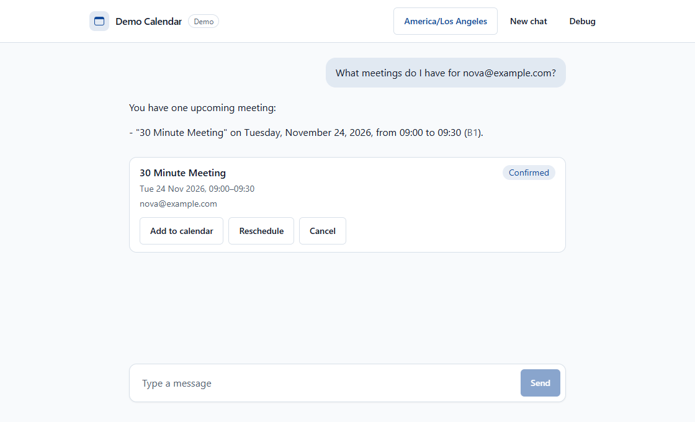
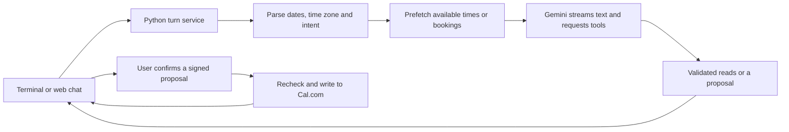

# LiveX Scheduling Assistant

A conversational Python assistant for booking, viewing, rescheduling, and cancelling meetings through Cal.com. It runs in a terminal and in a streaming Next.js chat. Every change shows a proposed time or booking and waits for confirmation.

[Local web chat](http://localhost:3000) · [Local widget demo](http://localhost:3000/widget-demo) · [Deployment plan](docs/deploy-plan.md)

[Live web chat](https://livex-scheduling-assistant.vercel.app) · [Live widget demo](https://livex-scheduling-assistant.vercel.app/widget-demo)



## Requirements

The LiveX brief requires an interactive Python chatbot that books, views, cancels, and reschedules meetings through the Cal.com REST API. Run it with `python -m backend.cli`. The Next.js web chat is the bonus interface and runs the same Python conversation and calendar actions. [Confirmed assignment brief](docs/DECISIONS.md#assignment-requirements)

| Flow | How to try it | Cal.com REST API |
| --- | --- | --- |
| Book | Ask for availability, select a time, provide your name and email, then confirm. | `GET /v2/slots`, `POST /v2/bookings` |
| List | Ask for upcoming meetings and give the attendee email if prompted. | `GET /v2/bookings` with the `attendeeEmail` filter |
| Reschedule | Choose a booked meeting, pick a different time, then confirm. | `GET /v2/bookings/{uid}`, `GET /v2/slots`, `POST /v2/bookings/{uid}/reschedule` |
| Cancel | Choose a booked meeting and confirm the cancellation. | `GET /v2/bookings/{uid}`, `POST /v2/bookings/{uid}/cancel` |

The client uses `GET /v2/me` and `GET /v2/event-types` to find the host and eligible events. The single-booking read also helps verify changes when a write times out. [Cal.com API verification](docs/calcom-notes.md)

At the Python terminal's confirmation prompt, type `y`. On the web, type `yes`, `yes please`, or `ok` in chat or click **Confirm** on the active proposal. Both use the name and email shown on the booking card. Fill in any missing details before confirming.

## Features

- **Web bonus** · Streaming replies, clickable time options and booking cards, a time-zone picker, and an embeddable demo. The web chat adds system dark mode, local history, keyboard controls, and a diagnostics drawer at `/?debug=1`.
- **Demo calendar** · `DEMO_MODE=fake` runs all four flows against a rolling in-memory calendar with a Gemini key and signing secret.

## How it works



Python parses dates and prefetches relevant calendar data before the model call. Gemini references options such as `S1` and bookings such as `B1`. The state token signs their mappings to exact calendar records. Python owns every write, rechecks the chosen record or time when you confirm, and streams status, text, cards, and turn metrics. The terminal and web clients use the same turn service.

## Code tour

| File | Responsibility |
| --- | --- |
| [backend/cli.py](backend/cli.py) | Runs the required Python terminal chat and accepts numbered choices and typed confirmations. |
| [backend/turn.py](backend/turn.py) | Orchestrates a turn, prefetches calendar data, and handles Gemini streaming and tool calls. |
| [backend/actions.py](backend/actions.py) | Rechecks signed proposals and executes confirmed booking, move, and cancellation actions. |
| [backend/cal_client.py](backend/cal_client.py) | Calls the Cal.com REST endpoints with per-endpoint versions and parses responses. |
| [backend/server.py](backend/server.py) | Serves the Flask warm-up and streaming chat endpoints. |
| [app/chat-workspace.tsx](app/chat-workspace.tsx) | Renders streamed messages, time choices, booking cards, and confirmation controls in the browser. |

## Local development

Use Python 3.12, Node.js 22, and pnpm. Create a virtual environment with `python -m venv .venv`.
Activate it with `.venv\Scripts\Activate.ps1` on Windows or `source .venv/bin/activate` on macOS or Linux.

```sh
python -m pip install -r requirements.txt
pnpm install --frozen-lockfile
```

Copy `.env.example` to `.env.local`. Create `GEMINI_API_KEY` in an unbilled Google AI Studio project. Generate `STATE_SIGNING_SECRET` with `python -c "import secrets; print(secrets.token_hex(32))"`. [Google AI Studio key setup](https://ai.google.dev/gemini-api/docs/api-key) · [Gemini free tier and data use](https://ai.google.dev/gemini-api/docs/pricing)

For the demo calendar, set `DEMO_MODE=fake` and leave `CAL_API_KEY` empty. The app uses simulated weekday availability from the current date. The Gemini key is still required, and fake bookings reset with the backend process.

For a real calendar, leave `DEMO_MODE` empty. On a Cal.com test account, set your time zone and availability, create a visible 30-minute event type, and assign the availability schedule to it. Generate an API key in **Settings → Developer → API Keys** and save it as `CAL_API_KEY`. Set `CAL_DEFAULT_EVENT_TYPE_SLUG` to the event's URL slug if the account has multiple event types. [Cal.com event setup](https://next.cal.com/blog/event-types-guide-calcom) · [Cal.com API key setup](https://next.cal.com/blog/where-is-my-api-key-and-what-can-it-do)

| Setting | Purpose |
| --- | --- |
| `GEMINI_MODEL`, `GEMINI_THINKING_LEVEL` | Default to 3.5 Flash-Lite with minimal thinking. |
| `GEMINI_FALLBACK_MODEL` | Defaults to 3.1 Flash-Lite. An explicit empty value disables backup calls. |
| `CAL_EVENT_TYPE_SLUGS`, `CAL_DEFAULT_EVENT_TYPE_SLUG` | Optional event allowlist and default. |
| `RATE_LIMIT_TURNS_PER_10MIN`, `DAILY_MODEL_CALL_CAP` | Per-IP throttle and process-local model-call budget. Set the budget below the project's AI Studio quota. |
| `FLASK_ORIGIN` | Optional loopback API origin for Next.js development. |

Run `pnpm check` to validate the environment. It reads Gemini model metadata and Cal.com's `/v2/me` in real mode, or Gemini metadata alone in fake mode. It prints setting names and failure classes without credential values.

Run `pnpm dev:api` and `pnpm dev` in separate terminals, then open `http://localhost:3000`.

A stalled primary model can switch to the free-tier 3.1 Flash-Lite backup. When a public Cal.com booking link is available, the web app can open its direct booking form.

For terminal chat, run `pnpm chat` or `python -m backend.cli` from the activated virtual environment. Type a displayed option number to pick a time and answer `y` or `n` at the confirmation prompt. Use `r` or `c` to move or cancel your latest confirmed booking. `/new` starts a fresh chat, `/tz America/Los_Angeles` changes the time zone, `/debug` shows the last turn's metrics, and `/quit` exits.

Run the checks from the repository root.

```sh
pnpm test
pnpm lint
```

## Evaluation

The evals run against a fixed clock and an isolated calendar fixture. Gemini calls use an unbilled AI Studio key. Cases 16, 18, 19, and 20 require three passes each. Other cases require two passes out of three.

| Model and sweep | Completed runs | Result | Safety runs | First text p50 / p90 | Text turn p50 / p90 |
| --- | ---: | --- | ---: | ---: | ---: |
| Gemini 3.5 Flash-Lite (`minimal`), first sweep | 69/69 | 19/23 cases qualified, 56/69 runs passed | 9/12 | 2.48 / 6.50 s | 4.32 / 9.40 s |
| Gemini 3.5 Flash-Lite (`minimal`), repeat sweep | 69/69 | 23/23 cases qualified, 68/69 runs passed | 12/12 | 2.33 / 9.27 s | 3.54 / 13.86 s |
| Gemini 3.1 Flash-Lite (`minimal`), single comparison | 23/23 | 21/23 cases passed | 4/4 | 2.22 / 3.40 s | 3.28 / 6.97 s |

The booking-list, reference reuse, and weekday-exclusion fixes landed between the two sweeps. A separate held-out set used eight new phrasings once each on 3.5 Flash-Lite and passed 5/8. [Full report and per-check results](docs/m7-eval-report.md)

The default remains 3.5 Flash-Lite. The 3.1 comparison used the updated stream deadlines and offer cap. The runner subtracts its pacing delays.

```sh
pnpm eval --model gemini-3.5-flash-lite --output evals/results/local-run.json
pnpm eval --report evals/results/local-run.json
```

The Python mapping, state signing, model fallback, and hosting choices are recorded in the project notes. [Design decisions](docs/DECISIONS.md) · [Milestone dev logs](docs/dev-log)

## Known limitations

- The browser-held session token is readable and includes booking IDs and the user's email. HMAC verifies the token's integrity. Use an isolated test account.
- Anyone who knows an attendee's email can look up or cancel that attendee's bookings in the demo.
- A production version would verify the attendee's email with a one-time code before showing or changing bookings.
- Per-IP limits, the daily model-call budget, and duplicate-confirm protection are held in each process's memory. They reset when the process restarts and are independent across instances.
- Stop ends the stream in the browser, but the server may finish the current Gemini call. Calendar changes require explicit confirmation.
- When Cal.com times out on a confirmed change, the app checks the booking records and reports what it can verify. If the records are inconclusive, check the calendar before submitting another change.
- Google can use free-tier Gemini prompts and responses to improve its products. Use fictional contact details in conversation and keep deliverable test aliases in the local Cal.com probe settings.
